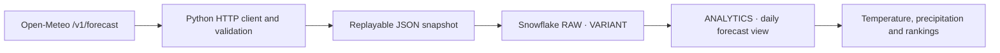

# Weather API to Snowflake

Fetch three UTC forecast days for Bucharest, Cluj-Napoca, Brașov, Iași,
and Timișoara. Store the validated payloads for replay, load them into
Snowflake, and query daily temperatures, precipitation, and city rankings.



The [Open-Meteo forecast endpoint](https://open-meteo.com/en/docs) offers
keyless access for this non-commercial portfolio demo. Follow the
[Open-Meteo terms](https://open-meteo.com/en/terms) for other uses.
Forecast values are model outputs. Dates represent UTC calendar days and
city coordinates are fixed in `weather.py`.

## Windows setup

From the repository root in PowerShell:

```powershell
py -3.14 -m venv .venv
.\.venv\Scripts\python.exe -m pip install -r requirements.txt
if (!(Test-Path .env)) { Copy-Item .env.example .env }
.\.venv\Scripts\python.exe -m pytest -q
```

## Fetch and inspect a live snapshot

```powershell
$python = ".\.venv\Scripts\python.exe"
$snapshot = "data/snapshots/demo.json"
& $python main.py fetch --snapshot $snapshot
Get-Content $snapshot -TotalCount 25
```

Without `--snapshot`, fetch writes `data/snapshots/YYYY-MM-DD.json`. The
default filename uses the current UTC date. An explicit `--start-date`
changes the fetch window and its default filename.
Use an explicit filename to replay older captures. A fetch only replaces the
file after all five responses pass validation. Fetching into the same path
replaces the previous capture. Keep separate filenames to retain revisions.

## Snowflake setup and verification

Fill in `SNOWFLAKE_ACCOUNT` and `SNOWFLAKE_USER` in your local `.env`.
The defaults use `OAUTH_AUTHORIZATION_CODE`, `SYSADMIN`, and the existing
`COMPUTE_WH`. Verify that the warehouse is X-Small with auto-suspend.
Use the OAuth values required by your Snowflake integration if it uses a
custom client, endpoints or redirect URI. Follow the browser prompt and
sign in through your configured Google identity provider. Each CLI command
opens a new connection and may prompt for sign-in. Keep OAuth credentials
in the local environment and keep `.env` out of Git.

The setup creates objects only in this project's database. The role needs
permission to create that database and use the warehouse. See the
[Snowflake connector authentication guide](https://docs.snowflake.com/en/developer-guide/python-connector/python-connector-connect).

```powershell
& $python main.py init
& $python main.py load --snapshot $snapshot
& $python main.py load --snapshot $snapshot
& $python main.py report
```

For a fresh database with one snapshot, expect five RAW keys and 15
analytics rows. The first report lists forecasts, the second ranks city
temperatures and precipitation within each date, and the third should
return zero duplicate RAW keys. To verify the counts explicitly:

```sql
SELECT COUNT(*) FROM WEATHER_PIPELINE_DB.RAW.FORECAST_SNAPSHOTS;
SELECT COUNT(*) FROM WEATHER_PIPELINE_DB.ANALYTICS.DAILY_FORECAST;
```

To verify precedence on overlapping dates, fetch and load a second
capture starting one UTC day earlier:

```powershell
$yesterday = (Get-Date).ToUniversalTime().AddDays(-1).ToString('yyyy-MM-dd')
$earlier = "data/snapshots/earlier.json"
& $python main.py fetch --start-date $yesterday --snapshot $earlier
& $python main.py load --snapshot $earlier
& $python main.py report
```

For these two captures alone, expect 10 RAW rows and 20 analytics rows.
The additional report checks should show a VARIANT column with OBJECT
payloads and ARRAY forecast dates, 10 overlapping city-days, and zero
wrong or missing winners.

## Data model and reruns

RAW stores one payload per city and forecast start date. A bound `MERGE`
inserts missing keys or updates existing keys only for newer captures.
The same snapshot can be replayed and an older capture cannot overwrite a
newer one. Load all five cities in one transaction. Run loads serially
because standard Snowflake table primary keys are informational.

The view flattens the date array, uses the array index to pair each date
with its metrics, then selects the latest start date for overlapping
forecasts by city and date. This retains the latest revision for each
city and start date and yields a single row per city and forecast date
in the reporting view.

## Verified live results

On 20 November 2026, a run with `SYSADMIN` and `COMPUTE_WH` loaded two
Open-Meteo captures into Snowflake. The three-day windows started on
19 and 20 November UTC.

| Check | Observed result |
| --- | --- |
| RAW and ANALYTICS schemas | Both present |
| RAW storage | 10 rows, VARIANT column with OBJECT payloads and ARRAY dates |
| Analytics | 20 city-days in each forecast and ranking report |
| Exact replay | Same 5 rows, timestamps, and payloads after reloading the first capture |
| Duplicate RAW keys | 0 |
| Overlap selection | 10 overlapping city-days, 0 wrong or missing winners |

The local suite passed 7 tests and 6 subtests. Its transaction tests
use a mock connection. The table above records the live Snowflake
verification separately.

See [interview preparation](docs/interview_prep.md) and [CV bullets](docs/cv_project_bullets.md).
